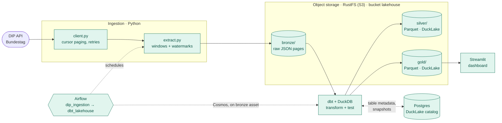
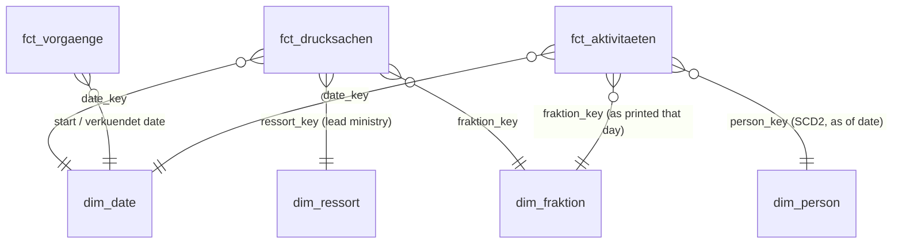
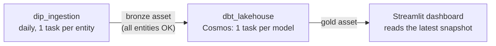

# Bundestag Open-Data Lakehouse

An end-to-end data platform on the open data of the German Bundestag. It pulls parliamentary
documents, procedures, activities and members from the official
[DIP API](https://dip.bundestag.de/über-dip/hilfe/api), lands them untouched in a **Bronze**
layer, cleans them into **Silver** tables and models them into a **Gold** star schema —
incrementally, idempotently, tested and orchestrated.

It answers questions like *which ministry produces the most printed papers*, *how long does a
bill take from first reading to promulgation* or *how active is each member of parliament*.

## Architecture



| Layer | Where | What it holds |
|-------|-------|---------------|
| **Bronze** | `s3://lakehouse/bronze/<entity>/dt=…/run=…/page=NNNN.json` | API responses byte-for-byte, one file per page, plus a `_SUCCESS.json` manifest per run. Never modified. |
| **Silver** | `s3://lakehouse/silver/<table>/*.parquet` (DuckLake schema `lake.silver`) | One table per entity, typed columns, nested arrays flattened into child tables, only the latest version of each record. |
| **Gold** | `s3://lakehouse/gold/<table>/*.parquet` (DuckLake schema `lake.gold`) | Kimball star schema, see below. |

Silver and Gold are [DuckLake](https://ducklake.select) tables: the data is Parquet in RustFS, the
catalog (which files make up which table, every snapshot) lives in Postgres. That gives ACID
writes, time travel and many concurrent readers — no database file to lock
([ADR 0004](docs/adr/0004-ducklake-for-silver-and-gold.md)).

### Gold star schema

Gold follows Kimball's dimensional modeling, which splits tables into two kinds:

| | **Fact** (`fct_`) | **Dimension** (`dim_`) |
|---|---|---|
| Holds | **events**: something happened | **context**: who, what, which group, when |
| Answers | "how many?", "how long?" | "... per Fraktion", "... by month" |
| Size | many rows, grows with every load | few rows, changes slowly |
| Example | `fct_aktivitaeten` (one row per activity) | `dim_fraktion` (one row per Fraktion) |

A rule of thumb: in *"MdB X (AfD) **asked** a Kleine Anfrage on 21 October"*, the verb is a
fact row; *X*, *AfD* and *21 October* are rows in `dim_person`, `dim_fraktion` and `dim_date`.
A fact row stores only **keys** to its dimensions plus its own measures and attributes, e.g.
`aktivitaet_id, date_key, person_key, fraktion_key, aktivitaetsart`. The facts sit in the middle
and the dimensions around them, hence *star* schema. Every question has the same shape: count or
sum a fact, group by a dimension:

```sql
select fr.fraktion_name, count(*) as aktivitaeten
from lake.gold.fct_aktivitaeten as f
join lake.gold.dim_fraktion as fr using (fraktion_key)
group by all
```

Why split them: names are stored once instead of on thousands of rows; the same (*conformed*)
dimension serves every fact, so "SPD" means the same in every chart; and the question shape stays
simple. Three rules keep it correct:

- **Grain:** each fact table states what one row is (table below). Mixing grains double-counts.
- **SCD Type 2:** a person's role or Fraktion can change. `dim_person` keeps one row per
  *version* with `valid_from` / `valid_to`, and an activity joins the version valid on its date,
  so a person can appear in several rows.
- **Unknown member:** every dimension has an *Unbekannt* row (key `-1`), so a fact with missing
  context (e.g. a minister, who has no Fraktion) still joins instead of disappearing.



| Table | Grain | Notes |
|-------|-------|-------|
| `fct_drucksachen` | one Drucksache | lead ministry, primary originator type, Fraktion |
| `fct_vorgaenge` | one Vorgang | steps, promulgation, `dauer_tage` |
| `fct_aktivitaeten` | one Aktivität | incremental; person version and Fraktion valid on that day |
| `dim_person` | one person version | SCD Type 2 from the `snp_person` snapshot |
| `dim_fraktion`, `dim_ressort` | one Fraktion / ministry | |
| `dim_date` | one day | weekday, month, Wahlperiode |

Example questions are in
[`dbt/analyses/`](dbt/analyses/); design notes in [ADR 0005](docs/adr/0005-gold-star-schema.md).

## Stack

| Tool | Role in this project |
|------|----------------------|
| Python 3.12 · httpx · boto3 | Ingestion: API client, Bronze writer |
| [RustFS](https://github.com/rustfs/rustfs) | Local S3-compatible object store ([why not MinIO](docs/adr/0001-rustfs-as-object-store.md)) |
| Apache Airflow 3 + Astronomer Cosmos | Daily orchestration, dbt models as tasks, asset-driven DAGs |
| dbt-core + dbt-duckdb · DuckDB | SQL transformations, tests, docs; DuckDB reads Bronze straight from S3 |
| DuckLake (catalog in Postgres) | Table format for Silver/Gold: Parquet in S3 + snapshots, time travel |
| Docker Compose | Runs RustFS, Airflow and Postgres (Airflow metadata + DuckLake catalog) locally |
| pgAdmin | Web UI for Postgres, both databases pre-registered |
| uv · ruff · pre-commit · GitHub Actions | Dependencies, linting, secret scanning, CI |

## Orchestration and CI



- **`dip_ingestion`** (daily) loads Bronze; only when every entity succeeded does it emit the
  `bronze` asset.
- **`dbt_lakehouse`** runs on that asset (or by hand). Cosmos shows every seed, model and the
  snapshot as a task; a single `dbt build` runs underneath (WATCHER mode), tests each model right
  after building it and skips everything downstream of a failure.
- **CI** runs dbt against `dbt/sample_data/bronze` with the `ci` target (local DuckLake, no
  services): a full build on `main`, and on pull requests a slim build of only what changed
  (`@state:modified` vs. the base branch).
- **dbt docs** (models, columns, tests, lineage) are published to GitHub Pages on every change to
  `dbt/` on `main`: https://geenccmustafa.github.io/bundestag-lakehouse/

Details: [ADR 0006](docs/adr/0006-orchestration-and-ci.md).

## Dashboard

A Streamlit app on the Gold star schema (`dashboard/`), in German like the data: headline
numbers, activities per Fraktion (point in time), papers per lead ministry, activity over time
(by day, week or month depending on the range), papers per weekday, activity kinds and
procedures per type. Filters: Wahlperiode and date range; every chart has its numbers as a table.

- **Read-only consumer.** It attaches the DuckLake catalog `READ_ONLY` and runs only SELECTs, so
  it can be open while dbt writes; each query sees the latest committed snapshot. The sidebar
  shows that snapshot and the newest DIP update in Gold.
- **Queries are plain SQL** in `dashboard/queries.py` (bound parameters, no Streamlit), tested
  against a hand-made Gold layer; CI also renders the whole app headless on the sample lake.
- **Light on the laptop:** it needs only Postgres and RustFS, not Airflow, and caches results for
  ten minutes.

Details: [ADR 0007](docs/adr/0007-streamlit-dashboard.md).

## Getting started

```bash
uv sync                          # Python env + dev tools
uv run pre-commit install        # run hooks on every commit
cp .env.example .env             # then replace every change-me value
docker compose up -d             # RustFS :9001, Airflow :8080, pgAdmin :5050 (localhost only)
```

Load data into Bronze:

```bash
uv run --env-file .env python -m ingestion backfill --days 7   # one idempotent run per day
uv run --env-file .env python -m ingestion extract              # incremental from watermarks
uv run --env-file .env python -m ingestion status
```

In Airflow, the `dip_ingestion` DAG does the same daily, one task per DIP entity.

Build and test Silver and Gold:

```bash
uv run --env-file .env dbt deps                # once: install dbt packages
uv run --env-file .env dbt build               # seeds, models, snapshot, data + unit tests
uv run --env-file .env dbt source freshness    # is Bronze up to date?
uv run --env-file .env dbt run-operation ducklake_maintenance --args '{days: 7}'  # drop old snapshots
uv run --env-file .env dbt compile --select path:analyses  # SQL for the example questions in dbt/target/compiled/
```

Without the stack (seconds, sample data only):

```bash
mkdir -p /tmp/bundestag-dbt-ci
BRONZE_ROOT=$PWD/dbt/sample_data/bronze uv run --env-file .env dbt build --target ci
```

After changing the dbt project, regenerate the manifest the Airflow DAG renders from:
`docker compose up -d airflow-init`.

Open the dashboard (http://localhost:8501):

```bash
docker compose up -d postgres rustfs                          # enough for the dashboard
uv run --env-file .env streamlit run dashboard/app.py
LAKE_TARGET=ci uv run --env-file .env streamlit run dashboard/app.py   # sample lake, no stack
```

Explore the data in the browser (DuckDB UI, read-only, http://localhost:4213):

```bash
uv run --env-file .env python scripts/duckdb_ui.py   # Ctrl+C to stop
```

Local web UIs (all bound to localhost):

| URL | What |
|-----|------|
| http://localhost:8080 | Airflow (login from `.env`: `AIRFLOW_ADMIN_USER` / `AIRFLOW_ADMIN_PASSWORD`) |
| http://localhost:9001 | RustFS console (`RUSTFS_ACCESS_KEY` / `RUSTFS_SECRET_KEY`) |
| http://localhost:5050 | pgAdmin: Airflow metadata DB and DuckLake catalog, no login needed |
| http://localhost:4213 | DuckDB UI, started by `scripts/duckdb_ui.py` |
| http://localhost:8501 | Streamlit dashboard, started by `streamlit run dashboard/app.py` |

DuckDB is embedded: there is no database server. Every process (dbt, the UI, the
dashboard) runs its own in-memory DuckDB and attaches the shared DuckLake catalog, so they can
all work at the same time.

## Project layout

```
ingestion/          DIP API client, Bronze writer, watermarks, CLI
dashboard/          Streamlit app on Gold (lake connection, SQL, page)
scripts/            Dev helpers (skill sync, DuckDB UI)
airflow/dags/       Airflow DAGs
dbt/                dbt project (sources, models, snapshot, seeds, tests); sample_data/ for CI
docs/adr/           Architecture decision records
tests/              Python unit tests
docker/             Airflow image, DuckLake catalog init, pgAdmin servers
docker-compose.yml  Local stack
```

Design decisions are recorded in [`docs/adr/`](docs/adr/).
