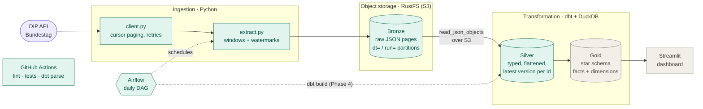

# Bundestag Open-Data Lakehouse

An end-to-end data platform on the open data of the German Bundestag. It pulls parliamentary
documents, procedures, activities and members from the official
[DIP API](https://dip.bundestag.de/über-dip/hilfe/api), lands them untouched in a **Bronze**
layer, cleans them into **Silver** tables and models them into a **Gold** star schema —
incrementally, idempotently, tested and orchestrated.

It answers questions like *which ministry produces the most printed papers*, *how long does a
bill take from first reading to promulgation* or *how active is each member of parliament*.

## Architecture



<sub>Green: built and running · Grey: upcoming phases</sub>

| Layer | Where | What it holds |
|-------|-------|---------------|
| **Bronze** | RustFS bucket `lakehouse`, `bronze/<entity>/dt=…/run=…/page=NNNN.json` | API responses byte-for-byte, one file per page, plus a `_SUCCESS.json` manifest per run. Never modified. |
| **Silver** | DuckDB `data/lakehouse.duckdb`, schema `silver` | One table per entity, typed columns, nested arrays flattened into child tables, only the latest version of each record. |
| **Gold** | DuckDB, schema `gold` *(Phase 3)* | Kimball star schema: `fct_drucksachen`, `fct_vorgaenge`, `dim_person` (SCD2), `dim_ressort`, `dim_date`, … |

## Stack

| Tool | Role in this project |
|------|----------------------|
| Python 3.12 · httpx · boto3 | Ingestion: API client, Bronze writer |
| [RustFS](https://github.com/rustfs/rustfs) | Local S3-compatible object store ([why not MinIO](docs/adr/0001-rustfs-as-object-store.md)) |
| Apache Airflow 3 | Daily orchestration, retries, backfills |
| dbt-core + dbt-duckdb · DuckDB | SQL transformations, tests, docs; DuckDB reads Bronze straight from S3 |
| Docker Compose | Runs RustFS, Airflow and Postgres locally |
| uv · ruff · pre-commit · GitHub Actions | Dependencies, linting, secret scanning, CI |

## Getting started

```bash
uv sync                          # Python env + dev tools
uv run pre-commit install        # run hooks on every commit
cp .env.example .env             # then replace every change-me value
docker compose up -d             # RustFS :9001, Airflow :8080 (localhost only)
```

Load data into Bronze:

```bash
uv run --env-file .env python -m ingestion backfill --days 7   # one idempotent run per day
uv run --env-file .env python -m ingestion extract              # incremental from watermarks
uv run --env-file .env python -m ingestion status
```

In Airflow, the `dip_ingestion` DAG does the same daily, one task per DIP entity.

Build and test Silver:

```bash
uv run --env-file .env dbt deps                # once: install dbt packages
uv run --env-file .env dbt build               # models + data tests + unit tests
uv run --env-file .env dbt source freshness    # is Bronze up to date?
```

## Project layout

```
ingestion/          DIP API client, Bronze writer, watermarks, CLI
airflow/dags/       Airflow DAGs
dbt/                dbt project: sources, bronze views, silver models, tests
docs/adr/           Architecture decision records
tests/              Python unit tests
docker-compose.yml  Local stack
```

Design decisions are recorded in [`docs/adr/`](docs/adr/).
